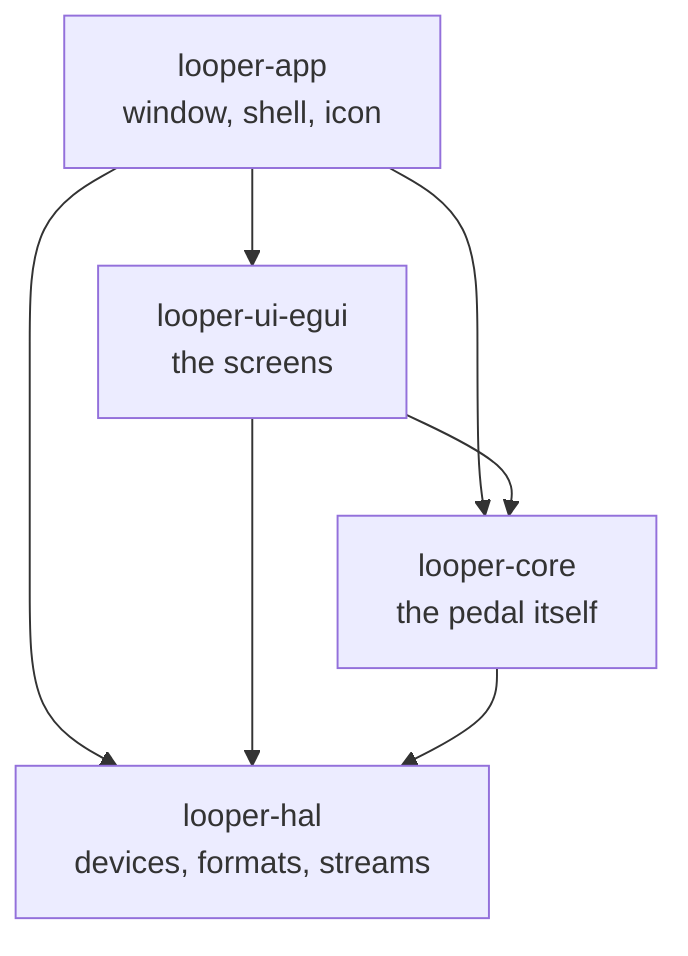
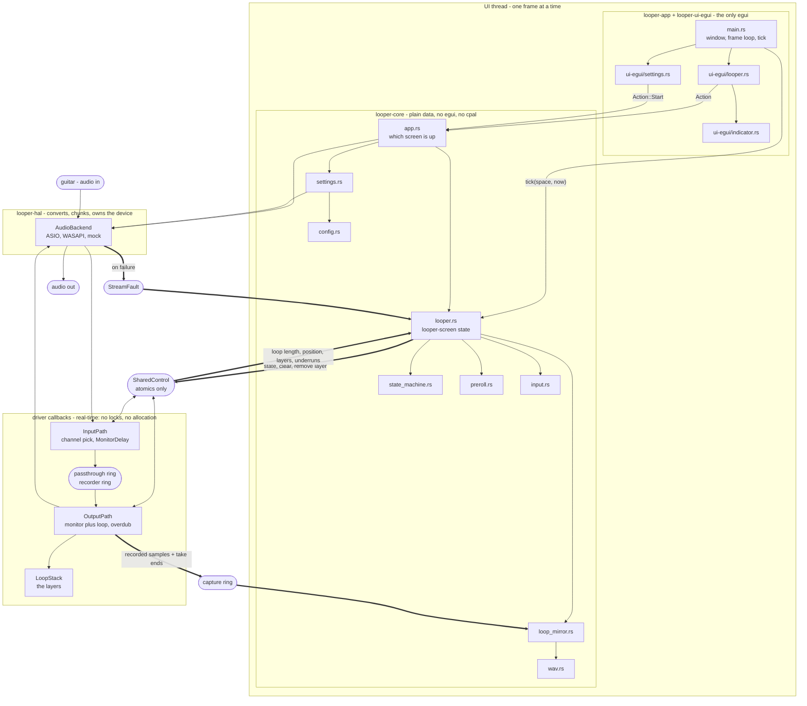

# Looper Pedal

A minimal single-track looper pedal replacement for practicing guitar
through an audio interface - one loop, stacked from overdub layers.
Standalone app, no DAW and no plugin host; Windows today, with the device
layer split off so that other platforms are a backend rather than a
rewrite. See `docs/user-guide.md` for how to use it; this document covers
the architecture and how to build it.

## Architecture

The app opens an audio device directly (input + output) rather than being
a plugin. Which device, and through which driver, is chosen in Settings:
ASIO where a driver is installed, WASAPI otherwise. Audio flows through a
lock-free pipeline driven by a state value published from the UI thread.

```
Guitar -> audio in (selected channel only) -> live monitor (always audible)
                                           -> mixed with loop playback
                                              (sum of all layers)
                                           -> duplicated to every output
```

Only the input channel chosen in Settings is captured - it's treated as
mono internally (recorded, looped) and duplicated equally across every
output channel, so a single guitar input is centered in both ears rather
than only coming out of one side. NAM (Neural Amp Modeler) integration is
explicitly out of scope for now - the signal is clean/dry throughout.

Samples are `f32` everywhere above the device, full scale at +/-1.0.
Whatever format the hardware actually speaks - i16, i24, i32, f32 - stops
at the backend, so no format assumption reaches the code that decides
what the app does. `sample.rs` owns the conversion at the two edges that
still deal in integers: the device, and the saved WAV.

### Crates



Not a chain, and the direction is the point. `looper-hal` sits at the
bottom and has never heard of loops, layers or takes; `looper-core` knows
what the pedal does and nothing about `cpal` or `egui`. So porting to
another operating system means writing an `AudioBackend`, and a second
look - or another toolkit - is a crate beside `looper-ui-egui` rather
than a change to either of the two below it.

`looper-hal` has no dependencies at all unless its `cpal` feature is
asked for, which is what lets `cargo test -p looper-core` run the bulk of
the suite on any platform with no audio SDK to build against.

### Thread boundary

The real-time audio callback stays strictly separate from UI/state logic:
no locks or allocations on the audio thread. State changes (button
presses, mode transitions) and telemetry (loop length, playback position)
cross the thread boundary via `SharedControl`, which is nothing but a
handful of atomics - no mutex anywhere in the audio path.

- **UI thread** owns `LoopStateMachine` (the actual state) and publishes
  its value into `SharedControl` whenever it changes.
- **Audio thread** (the output callback) owns `LoopStack` exclusively -
  it's never shared with the input callback. The input callback only
  reads `SharedControl`'s published state to decide whether to feed
  captured samples toward the recorder.

Every request and level that crosses, who sets it, and the order the
output callback reads them in is one table, on `SharedControl` itself -
the order is load-bearing (an abandon must be seen with the state change
it rides on, a next-layer before it), so it lives beside the code.

Both callback bodies are `InputPath::process` and `OutputPath::process`,
which is how the backend reaches them: they implement `looper-hal`'s
`InputProcessor` and `OutputProcessor`. Those impls live in `looper-core`
because the orphan rule puts them there, and rightly - the paths and the
promise they keep (no allocation, no locks, bounded work) belong
together. It also means the whole path can be driven by a test without
opening a device, which is how the recording alignment below is measured.

The callback only ever sees the published state *value*, never the
transitions, so it detects those itself by comparing against the state it
saw last: that's when the loop length gets fixed and an overdub layer is
opened or closed.

The one thing that crosses without being an atomic or a ring is
`StreamFault`, which a failing stream writes to and the screen reads. It
is deliberately *not* part of `SharedControl`: it is touched at most a
handful of times in a stream's life, and only once one has already gone
wrong, so a lock there costs nothing and keeps the message a flag could
not.

## Writing a backend

A backend is an `AudioBackend`, and there are four things it answers:
what devices exist, what each will agree to, how to negotiate a format,
and how to start. `looper-hal/src/mock.rs` is the smallest complete one -
no device behind it at all - and `cpal_backend.rs` is the real one.

Three things the existing backends had to get right, all of them learned
from hardware rather than from documentation:

- **A device is identified by name *and* direction.** WASAPI presents an
  interface's capture and render halves as separate devices under the
  *same name*, so a lookup by name alone finds whichever the driver
  listed first. Worse, handing a render endpoint to a capture stream does
  not fail - `cpal` turns it into a loopback and you silently record the
  speakers. `caps` takes a whole `DeviceInfo` for exactly this reason.
- **Opening is two-phase.** `open` negotiates and stops; `start` takes
  the processors. The caller cannot build them earlier, because ring
  sizes, the monitoring delay and the layer stack are all measured in
  samples against the rate and channel counts that were actually
  *granted* - and a shared-mode endpoint hands back its own mix rate
  whatever was asked for.
- **Input and output channel counts are separate.** On a split backend
  the capture end is often narrower than the render end. One count fed to
  both paths de-interleaves at the wrong stride, which produces no error
  at all - just the wrong samples.

Two `looper-hal` examples exist to be run against real hardware, since
none of this can be checked without it:

```powershell
cargo run -p looper-hal --features asio --example list_devices
cargo run -p looper-hal --features asio --example open_device -- asio
```

`open_device` opens a device for real and reports drift and wander
between the two ends - see "Recording alignment".

## Module layout

Solid arrows are plain calls. Thick arrows cross a thread boundary, and
only ever through atomics or a ring buffer.



Three asymmetries the picture makes plain, and the prose above hides:

- **Nothing reaches into the audio side.** Everything the UI thread
  wants done crosses as a value it writes and forgets - a state, a
  one-shot flag - and `LoopStack` is only ever reachable from inside
  `OutputPath`. There is no arrow pointing at it from the left.
- **The two directions carry different things.** UI to audio is a
  handful of atomics. Audio to UI is those, plus a whole stream of
  samples through the capture ring, which is why the UI thread's copy
  of the loop exists at all.
- **`ui-egui/` is a leaf.** It reads a model and returns an `Action`; it
  never writes one. Swapping GUI library means replacing that crate and
  `main.rs`'s shell, and nothing below them.

The files themselves:

```
crates/
  looper-hal/                devices, formats, streams - no looping
    src/lib.rs                the traits and types every backend meets
    src/cpal_backend.rs       ASIO and WASAPI, behind the `cpal` feature
    src/mock.rs               a backend with no device, for tests
    examples/                 list_devices, open_device - need hardware
  looper-core/               the pedal itself - no cpal, no egui
    src/looper.rs             looper-screen state: state machine, the
                              audio relay, the live stream, per-frame tick
    src/looper/pedal.rs       what press, double, hold and stop do, from
                              every state in every record mode
    src/settings.rs           settings-screen state: backend/device/rate
                              lists and what's selected
    src/action.rs             what a rendered frame asks the app to do
    src/config.rs             the settings, as TOML in the per-user
                              config dir (config_tests.rs)
    src/input.rs              press (on the way down), double, long press
    src/state_machine.rs      the pedal logic - pure, no audio, no egui
    src/tempo.rs              a loop's tempo from its length, and ½ / 2×
    src/preroll.rs            the countdown before the first recording
    src/tap_tempo.rs          a tempo from taps: the last four gaps, averaged
    src/loop_mirror.rs        the UI thread's own copy of the loop, and
                              what saving it writes (loop_mirror_tests.rs)
    src/loop_writer.rs        the saved loop's files, written off the UI
                              thread (loop_writer_tests.rs)
    src/wav.rs                mono 32-bit PCM, by hand (wav_tests.rs)
    src/sample.rs             f32 <-> 32-bit PCM, one definition
    src/audio/engine.rs       the audio path, and opening a looper on a
                              backend (engine_tests.rs)
    src/audio/loop_stack.rs   pre-allocated stack of aligned mono layers
    src/audio/shared_control.rs  lock-free UI <-> audio thread relay
    src/audio/fault.rs        where a failing stream leaves word
    src/audio/click.rs        the metronome click, built per stream rate
    src/audio/scheduler.rs    where a pattern's steps fall at a tempo,
                              and a voice to play a one-shot on them
    src/audio/metronome.rs    the click track, on its own count or the loop's
  looper-ui-egui/            rendering only - `render(ui, model) -> Action?`
    src/looper.rs             the looper screen
    src/settings.rs           the settings screen
    src/indicator.rs          state circle + label + progress bar widget
  looper-app/                the binary
    src/main.rs               eframe glue: window, frame loop, tick
    src/app.rs                which screen is up, and acting on actions
    src/icon.rs               the app icon, drawn as RGBA at any size
    build.rs                  generates the .ico from `icon.rs`
```

`looper-core` holds no `egui::` types at all and `looper-hal` holds no
looping logic, so neither end can quietly acquire a dependency on the
other. `main.rs` and `looper-ui-egui` are the only framework-aware parts.

Tests live in sibling `*_tests.rs` files (via `#[path = "..."] mod tests;`)
rather than inline, to keep the implementation files themselves short -
see any of the pairs above. Run them with `cargo test`.

## State machine

The two-pedal layout most loopers share (Boss RC-30, Ditto X2, the NUX
Dual Loop with its CTRL switch): a main control that never stops, and a
stop.

| From | Press | Stop (`S`) |
|---|---|---|
| **Idle** | **Recording** (or **Arming**, below) | - |
| **Recording** | ends the take: **Looping**, or **Overdubbing** in both REC→DUBs | ends the take: **Stopped** |
| **Looping** | **Overdubbing** - nothing with every layer used | **Stopped** |
| **Overdubbing** | keeps the layer: **Looping**, or the next layer in REC→DUB | keeps the layer: **Stopped**, or **Looping** in REC→DUB |
| **Stopped** | **Looping** | - |

`record_mode` picks the cells that differ. REC→DUB never leaves dubbing
on a press, so its stop steps down - dubbing to playing to stopped. The
press ending the first take into a dub publishes `Overdubbing` straight
from `Recording`, which the audio thread already takes in one go - close
the take, round it to the bar, open a layer at the top - and reports both
takes' ends, so the mirror splits them where the stack did. Not with
`max_layers = 1`: there's no layer to dub into.

REC→DUB's "next layer" changes no state, so it crosses as a request of
its own (`request_next_layer`): the audio thread closes the open dub and
opens the next on the same sample, reporting the end like any other.
It's taken after loading the state and before applying it - a state
change seen means the request made before it is seen too, so a double
press's take-back can't land on the layer before the new one.

REC→DUB with **a layer per pass** splits the same way with no request:
once the dub in progress has covered the loop (`LoopStack::pass_left`
reaches 0), the callback closes it and opens the next - mid-block if
that's where the pass ends, by processing the block in pieces. Counted
from where the dub opened, not the top, so a phrase across the top
stays whole. With no slot left there's no pass end, and the last layer
sums passes as any dub does. The mode is read from the settings when
the audio path is built; changing it rebuilds the looper anyway.

A **long press** fires the moment the hold crosses the threshold while
still held, not on release. How long that is is the `long_press_ms`
setting, 2s by default, for both controls. Held, **Stop clears** the loop
from any state, back to Idle - Stop has an `InputHandler` of its own, fed
by the S key and its button's latch. Held, the **main control undoes**
the last layer, one per hold. Its press has already acted by then, so
the hold takes it back first, from `pressed_from` like a double: a dub
the press opened is abandoned, a stopped loop it played stops again, and
a first take it ended (or began) goes with the clear it turns into. The
undo itself waits in `undo_pending` until the abandoned dub is seen
dropped - `take_in_flight`, as for the Undo button - so the stack and the
copy agree on which layer is last. Never the first take.

**Stop mode.** `stop_mode` makes Stop (and the double press) play out
to the loop end or fade, rather than cut. The audio thread carries it
out, to the frame: `request_stop` sets a *level* in `SharedControl`, not
a one-shot, which the callback acts on every block the loop plays -
reading up to the top, or scaling by the fade - then *parks*: silent,
`play_pos` held, `stop_done` set. The UI thread publishes `Stopped` on
seeing that, so the state says Looping until the audio is actually
quiet, and the screen says why. A loop held at its end starts again from
the top. The request stays set while Stopped and is cleared before any
state leaving it is published (`cancel_stop`), so the callback can't
read the new state with the old request and play a block past where it
held. Stop again while it runs means now; Space calls it off and only
that. Ending a first take is always immediate - nothing has played yet.

A **double press** - two within 400 ms (`input.rs`) - does what Stop
does, for one key or pedal. Since a press acts as it goes down, the first
half has already happened by the time the second arrives, so the double
takes it back first, from the state it remembers the first acting from
(`pressed_from`): a dub the first half opened is *abandoned* -
`request_abandon_take` is set before the state change is published, the
audio thread drops the open layer rather than counting it and reports it
dropped, and the mirror skips its samples - and a take or count-in begun
on an empty looper leaves it empty. Three quick presses are a double and
a single, not two doubles.

A **press** acts the moment the control goes down, not when it's let
go. Waiting for the release, to be sure a press wasn't the start of a
hold, made every take start and stop as late as the key stayed down -
100-200 ms. Acting at once is safe because a hold takes back whatever
the press had started. A held key doesn't repeat
the press either: `InputHandler` reads whether the control is down, not
the OS's key-repeat events.


### Record start

`record_start` picks how a first take opens. Every one but `instant`
goes through **Arming** first; it's for the first recording only - once
a loop is playing you're already in time with it - and a press or Stop
part-way through calls it off, back to Idle.

| `record_start` | Arming ends | Timed on |
|---|---|---|
| `instant` | - (straight to Recording) | - |
| `delay` (default) | after `preroll_ms`, a bar filling as it runs | the UI thread |
| `count_in` | on the bar line after one bar of clicks | the audio thread |
| `detect` | at the first sample reaching `detect_db`, opened 10 ms before it | the audio thread |

It replaces "metronome on means count-in": a count-in is at home and
wrong on stage, and the metronome is a separate thing to want.

The countdown runs on the UI thread, which already ticks every frame and
already works in `Instant`: the callback keeps nothing until the state
flips to `Recording`. Input is handled before the countdown each frame,
so a press meant to cancel wins over the countdown happening to run out
on the same frame.

For a **count-in** and **detect** the roles reverse: the *audio
thread* opens the take, to the frame - mid-block if that's where the bar
line or the note falls - and the UI thread moves to `Recording` when it
sees the take growing (`audio_start`). A UI frame would land the start
up to ~20 ms late: the whole loop would sit that far off the click for
good, or clip the attack of the first note. The count-in clicks with the
metronome off too; detect keeps the last 10 ms of input round and round
(`Detector`), since a pick's attack climbs to the level it's caught at.
Three things make it work:

- The input feeds the recorder ring through `Arming` too, and the
  output drains it, so the ring is already flowing at the line rather
  than filling from empty.
- The UI thread's copy is fed by the *output* path, with exactly what
  the stack recorded, and told by it where each take ended - see "Why a
  second copy exists".
- A count-in or detect cancelled after its take opened arrives as `Arming` ->
  `Idle` with a take open; the stack drops it and reports it dropped.

### Layers

The first recording fixes the loop length; each overdub adds another
layer on top, and playback is their sum. `max_layers` of them can be
stacked, eight by default, and the newest can be dropped again
("Undo"). Never the first take: emptying the loop is a clear's job.

"Redo" brings a dropped layer back. It costs almost nothing: removing
only lowers the stack's count, and the samples stay in the buffer until
the next take is recorded into that slot. So the stack counts how many
layers above `count` are still intact, and forgets them all the moment a
take begins. A long-press clear stays final. The mirror keeps the dropped takes for the same window, so
a redone layer is saved again; the two are driven by the same events and
a test holds each to the same rule. Not across restarts.

Each layer is a full-length pre-allocated buffer, but an overdub can
start anywhere in the loop and be stopped early, so a layer only counts
as recorded over the window it was actually played into (`written`
samples from `start`). Outside that window it's never read, which is what
lets a layer be reused without memsetting megabytes inside the audio
callback. Two consequences worth knowing:

- A take is mixed in *before* the incoming sample is written over it, so
  you never hear the pass you're currently playing echoed back on top of
  your live signal - it comes back from the next pass onward.
- Overdubbing past the end of the loop sums into the same layer rather
  than replacing it, so a second pass doesn't erase the first.

In extended mode each finished layer can be muted. The UI thread owns a
bitmask, one bit per layer, and publishes it whole through
`SharedControl`; the output callback hands it to the stack each pass,
and `mix_at` skips the set bits. A muted layer is still recorded,
counted and saved - only playback leaves it out. Removing a layer or
clearing drops its bit, so an overdub recorded into the freed slot
doesn't come out muted. Mutes aren't saved: a loop reopens with every
layer playing.

### Layer volume

There is no per-layer gain: every layer plays back at the level it was
recorded at, and the looper screen's single **Loop** level is the only
control over them - it scales the whole stack, still leaving the live
passthrough alone. **Click** beside it scales the metronome the same
way, through `Voice::add_into`'s gain, which the drums will use too.
Both cross as atomics and are heard at once; the config is saved when a
slider is let go, not on every frame of a drag.

Stacked takes can sum past full scale, and nothing upstream clamps them:
the loop volume is applied to the whole sum, and what is still over full
scale is clipped once, at the conversion out to the device. Clamping
earlier would make a hot stack permanently crunchy - and would take the
live passthrough down with it, since the dry signal is added *after* the
loop bus. This way turning the loop volume down still recovers it.

### Metronome

`M` toggles it through `SharedControl`. The tempo is `metronome_bpm`,
and `,` / `.` (or the buttons beside the toggle) nudge it live: the UI
thread publishes it through an atomic and saves the config, and the
callback picks it up on its next block. A change keeps the click's place
in the bar - its own count is rescaled to the new grid rather than left
to land anywhere on it. The click is added to the output after
the loop, so it plays over everything and isn't scaled by the loop
volume.

`time_signature` sets the bar - `Pattern::metronome(beats)`, a step a
beat - and beat one plays a second sound, the same burst a fifth up
(`click::accent`), chosen from the step the scheduler reports. Both
threads build the bar from the same setting: the audio thread to count
in and round a take, the UI thread to wait for the bar line and count a
loop's beats. The tempo guess counts in its bars too: a bar's beats
times a power of two, halved below a bar while the beats split evenly.
It's fixed for the stream, like the record modes - changing it under a
loop would reinterpret the loop's bars.

What the click keeps time with depends on the state:

| State | Clicks follow |
|---|---|
| Looping, Overdubbing | the loop's play position - beat one is the top of the loop |
| Recording | its own count, restarted as the take opens, so the take starts on a click |
| Arming | its own count, restarted as the pre-roll starts - the count-in |
| Idle, Stopped | its own count |

The click is heard through the output, like the loop, so a part played
against it is recorded with the same alignment as an overdub.

With the metronome on, a first take comes out a whole number of bars -
the nearest, at least one. The split is deliberate: the *audio thread*
rounds (`finish_first_layer_in_bars`), cutting a late stop back and
letting the recorded window play silence after an early one, so the
length is exact to the frame. The *UI thread* only decides when to stop:
if the nearest bar line is still ahead, it holds the state at
`Recording` until the telemetry passes it, then stops as usual. That
keeps the input path gated on the published state exactly as before -
nothing is ever recorded after the state says it has stopped. The first
take's end report carries the length it was rounded to, and the mirror
lays the take out cut at that length rather than wrapped, so the saved
loop is the one that plays.

Once a loop exists it sets the tempo (`tempo.rs`): the click follows
the loop rather than `metronome_bpm`, so it lands on the loop's top
every time round. Played against the click, the loop is a known number
of bars and the tempo is the click's, recomputed from the exact length.
Played without it, the beat count is guessed - the power of two that
puts the tempo in 70-140 BPM, one doubling wide so exactly one fits -
and ½ / 2× correct a wrong guess. Those are the only changes offered:
halving needs an even beat count, so the click still meets the top. The
tempo is an `f64` all the way to the callback, since a loop's is rarely
whole; the UI thread works out which tempo applies and publishes it
every frame.

### Recording alignment

The dry passthrough carries `latency_ms` of headroom between the two
callbacks - that headroom is what absorbs their jitter - so you hear
yourself that much after the fact. The recorded signal is held back by
the same amount (`MonitorDelay`) before it reaches either the layer
stack or the UI thread's copy. Without that, the sample stored at loop
position p would be a whole monitoring delay fresher than the one heard
at p: takes would land ahead of the beat they were played against, and
every layer stacked on top would inherit the error again. An
`engine_tests.rs` measurement drives both callbacks with a ramp and
asserts the offset is zero.

The rings hold `latency_frames + MAX_BLOCK_FRAMES` so a driver buffer
larger than the delay still fits - the prefill, not the capacity, is
what sets the delay.

All of that assumes the two callbacks are driven by one clock, which is
worth knowing because backends differ sharply. Measured with
`open_device` against an Audient iD4 at 44.1 kHz:

| | ASIO | WASAPI (same interface) |
|---|---|---|
| shape | one duplex handle | two endpoints, same name |
| callback period | 64 frames (1.5 ms) | 441 frames (10 ms) |
| render block | fixed | variable, up to ~970 |
| drift | 0 ppm | 0 ppm |
| wander | 64 frames (1.5 ms) | 882 frames (20 ms) |

Neither **drifts**: WASAPI's shared mode runs both ends through the
Windows audio engine, which resamples onto its own clock - so even two
*different* interfaces stay in step. What differs is the **wander**.
ASIO's 64 frames is the floor, being exactly one callback period; WASAPI
swings by twenty milliseconds, and `MonitorDelay` holds back by a fixed
amount, so nothing takes that back out. A take can land either side of
where it was heard, and every layer inherits it again. The settings
screen says so when a split backend is chosen.

## Settings & persistence

On first run (or if the saved config no longer opens - e.g. the interface
was unplugged), the app shows a Settings screen: pick the driver, the
device, sample rate and input channel, and set anything in the table
below. A driver whose devices do both directions (ASIO) shows one device
picker; one whose devices are single endpoints (WASAPI) shows two, and
the rates offered are the ones *both* ends will take - a shared-mode
capture endpoint often offers only its own mix rate while its render half
claims a range it would have to resample to reach. On
"Start" this is saved and the app launches straight into the looper on
subsequent
runs. The gear icon (top-right, in the looper screen) reopens Settings at
any time, pre-selecting whatever's currently active.

Settings are TOML in the per-user config directory:

- Windows: `%APPDATA%\looper-pedal\config.toml`
- Linux: `~/.config/looper-pedal/config.toml`
- macOS: `~/Library/Application Support/looper-pedal/config.toml`

Next to the executable - where they used to live - stops being writable
the moment the app is installed somewhere like Program Files, and the
recorded loop will want a per-user directory of its own soon anyway.

`device_name` and `sample_rate` are required; everything else falls back
to a default, so a config written by an older build still loads instead
of throwing you back to the settings screen. Unknown keys are ignored,
and comments are allowed, so the file is safe to hand-edit.

Two of those defaults encode what an older file *meant* rather than a
preference: a missing `backend` reads as `"asio"`, because every config
written before there were backends came from a build that could only open
ASIO, and a missing `output_device_name` means the output is the input
device, which is what a duplex driver has. Retargeting somebody's
interface on upgrade is the kind of thing that reads as the app
breaking.

Every setting's default and allowed range is declared once, in
`config.rs`: the settings screen builds its sliders from those ranges,
and a hand-edited file is clamped to them on load. Nine hundred layers
of a two-hour loop would otherwise try to allocate terabytes before the
window opened.

| Setting | Default | Range | Effect |
|---|---|---|---|
| `volume_pct` | 100 | 0-200 | loop playback gain, live signal untouched - set on the looper screen |
| `click_volume_pct` | 100 | 0-200 | metronome gain; 100 is the click as generated, half full scale |
| `record_start` | `"delay"` | `"instant"`, `"delay"`, `"count_in"`, `"detect"` | how a first take opens - see "Record start" |
| `preroll_ms` | 4000 | 0-5000 | the wait, with `delay`; 0 = none |
| `detect_db` | -40 | -60 to -10 | the level that opens a take, with `detect` |
| `stop_mode` | `"immediate"` | `"immediate"`, `"loop_end"`, `"fade_out"` | how a playing loop stops - see "Stop mode" |
| `fade_ms` | 3000 | 500-10000 | the fade, with `fade_out` |
| `long_press_ms` | 2000 | 500-4000 | how long a hold is: Space to undo, S to clear |
| `metronome_bpm` | 120 | 40-300 | metronome tempo |
| `time_signature` | `"4/4"` | `"4/4"`, `"3/4"`, `"6/8"` | the metronome's bar - 6/8 clicks the eighths |
| `record_mode` | `"rec_play"` | `"rec_play"`, `"rec_dub"`, `"rec_dub_per_pass"` | see "State machine"; the older `after_take = "play"/"dub"` still reads |
| `latency_ms` | 8 | 2-50 | callback headroom - raise it if the log reports underruns |
| `max_loop_secs` | 60 | 10-120 | longest recordable loop |
| `max_layers` | 8 | 1-8 | layers including the first recording |

The last two are a memory multiplier - every layer is pre-allocated at
the full loop length, so it costs `seconds x layers x sample rate x 4`
bytes, and the settings screen shows the figure next to the sliders.

`mode` (`"mini"` or `"extended"`, default mini) is the one setting not
on the Settings screen: it's the Mini / Extended switch in the looper
screen's top row, saved the moment it's flipped. The switch works in
`Idle` and `Stopped`, never while anything plays or records - and
`Stopped` has to count, since a saved loop always comes back stopped.
Going to mini unmutes every layer: mini has no layer row, so a mute
kept there would be silence with no visible cause.

Deliberately *not* settings, and living in `looper-hal` because they are
statements about devices rather than about the app: `MAX_BLOCK_FRAMES`
(the bound on one callback - what a driver might hand us, not how anyone
wants the app to behave; it sizes the scratch buffers and the headroom in
the rings) and `CANDIDATE_SAMPLE_RATES` (a probe list, not a choice).
Nor are the window and widget sizes.

## Saved loops

The recorded loop survives closing the app: one WAV per layer, beside the
config -

- Windows: `%APPDATA%\looper-pedal\loop\layer-1.wav`, `layer-2.wav`, ...

Mono 32-bit PCM, written by hand (`wav.rs`) rather than through a
dependency. They're deliberately ordinary files: any editor opens them,
and the eventual "export loop" feature becomes a copy rather than a
converter.

Beside them, `tempo.toml` holds the loop's beat count - only that: the
tempo follows from it and the loop's length exactly, and saving the BPM
too would only let the two disagree. It's written when the loop gets its
tempo and after every ½ / 2×, and left alone by a layer save, which
deletes any WAV past the layers it keeps. Missing, unreadable, or naming a tempo the click
can't play, and the tempo is guessed from the length instead - which is
also what a loop saved before the file existed gets.

Written whenever the loop changes, not on the way out, so a crash or a
kill doesn't lose it - and only what changed: an overdub writes its own
layer, an undo deletes one file. The writing happens on a thread of its
own (`loop_writer.rs`), with every file operation on the loop - layers,
tempo, a clear's delete - queued there in the order asked. Written
inside a frame, a save of 8 x 60 s held up the presses read in that
frame, and the takes they started or ended landed late. Closing the
looper waits for the queue to empty, so the next start loads what was
written. On launch the layers come back and the looper
starts **Stopped** - the loop is there, silent until asked for. A saved
loop is discarded rather than adapted if it was recorded at a different
sample rate (there's no resampling) or is longer than `max_loop_secs`
now allows; layers past `max_layers` are dropped on their own, the ones
underneath being independent takes. `loop_mirror::load` decides all of
that in one place, so the layer stack and the UI thread's copy are
always seeded from the same list.

### Why a second copy exists

`LoopStack` lives inside the output callback, where nothing may reach in
and read it - so the UI thread keeps its own copy (`loop_mirror.rs`) to
have something it can write. Same lock-free audio -> UI direction as
the telemetry; no lock anywhere near the callback. Two rings carry it:

- **Samples** - the output callback passes on exactly what the stack
  recorded, after recording it, so the two hold the same audio.
- **Take ends** - as each take ends, how many of those samples were its,
  and what it was: a first take (with the length the stack settled on),
  an overdub (with where it began), dropped, or a clear.

The copy splits the sample stream by those counts, not by its own state
changes. Those reach the stack a callback later - up to 1.5 ms on ASIO,
10 ms on WASAPI - and some never reach it at all, so splitting by them
lost a take's last block and, after recording straight into a dub, put
it at the start of the overdub. Each frame it reads the ends *before*
draining samples: a take's samples are passed on before its end, so an
end read always has all its samples in. Remove and redo wait while the
audio thread still has a take open (`take_open`, published last), since
until its end arrives the copy and the stack disagree on which layer is
last.

A dub is folded onto one loop length as its samples arrive - the first
pass over a position replaces, later ones sum - so however long anyone
dubs, the copy is never more than a second stack's worth; only putting
the dub's start back is left for saving. Samples drained in the same
frame as a take's end could belong to the next take, so only those from
earlier frames are folded: a take that ended before them would have
reported it by now. A first take has no length to fold onto, and is
kept as played - bounded by the stack's capacity, since only what the
stack kept is passed on. Two consequences worth knowing:

- **The overdub layout rule exists twice**: the audio thread applies it
  sample by sample as it plays, the mirror as the samples reach it. A
  test asserts the two agree, because drift between them would mean a
  loop that reloads sounding different from the one that was played.
- **If samples ever go missing** on the way to the copy (its ring
  overflowing because the UI stalled), the save is skipped rather than
  writing a loop that doesn't match what was heard. The count comes back
  through `SharedControl` like the underrun counters.

## Build prerequisites (Windows)

- Rust via `rustup`, MSVC toolchain (`x86_64-pc-windows-msvc`)
- Visual Studio Build Tools - "Desktop development with C++" workload
  (needed for linking, and for compiling the ASIO SDK's C++ shim)

Everything below is needed only for the **ASIO** backend, which the app
crate asks for by enabling `looper-hal`'s `asio` feature. WASAPI needs
none of it, and neither does `cargo test -p looper-core`:

- LLVM/libclang (needed by `bindgen`, which `asio-sys` uses to generate
  bindings to the ASIO SDK headers)
- Steinberg ASIO SDK - dual-licensed (GPLv3 or proprietary) since Oct
  2025; `asio-sys` (used by `cpal`) auto-downloads it during
  `cargo build` if `CPAL_ASIO_DIR` is left unset, so there's normally
  nothing to fetch by hand

## Building & running

```powershell
cargo build                  # compile the workspace
cargo run -p looper-app      # build + launch
cargo test                   # every crate - no device needed, audio path included
cargo test -p looper-core    # the bulk of the suite, and no ASIO SDK to build
```

The last line is the one to reach for on a machine - or a platform -
without the ASIO SDK set up: `looper-core` depends on `looper-hal` with
its `cpal` feature off, so nothing device-shaped enters the build.

The app icon is drawn in code (`icon.rs`) rather than stored as an
image: a green loop arrow around a red record dot. That means no
image-decoding dependency and no binary asset in the repo, and it
renders at any size - the window asks for one, and `build.rs` `include!`s
the same file to generate a multi-size `.ico` for the executable's icon
resource. Embedding needs `rc.exe` from the Windows SDK; if it's missing
the build warns and carries on without the exe icon.

Debug builds are console-subsystem binaries, so `cargo run` keeps a
terminal alongside the window - that's where the stream config and the
underrun log print. Release builds set `windows_subsystem = "windows"`
and have no console at all, so the two things worth knowing about reach
the looper screen instead: a stream that fails says so with a button back
to Settings, and underruns show as a count naming the setting that fixes
them. The console still carries more detail, so a debug build is still
the better place to chase audio trouble from.

The app is developed against an Audient iD4 MkII, but no longer assumes
anything about it: the backend negotiates whatever format a device
reports (i16, i24, i32 or f32) and converts at the edge, so other
interfaces should work. ASIO is what it is tuned for - WASAPI runs, and
is what a machine with no ASIO driver gets, at roughly an order more
latency and with the timing wander noted under "Recording alignment".
