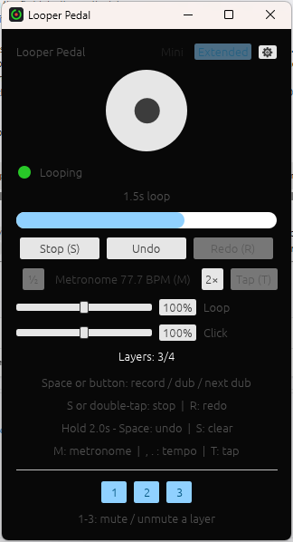

# Looper Pedal - User Guide

A simple looper pedal for practicing guitar, replacing a hardware looper
like the TC Electronic Ditto. Two controls, like a two-pedal looper: a
main one that records, plays and stacks layers, and a stop.

## First run

The first time you launch the app, you'll see a **Settings** screen:

1. **Driver** - how the app talks to your interface. Pick **ASIO** if
   it's offered: it's what your interface's own driver provides, and it's
   the one with low enough latency to play through comfortably. **WASAPI**
   is always there and needs no driver of its own, but it's noticeably
   less immediate - see "If ASIO isn't offered" below. This row only
   appears when there's more than one to choose from.
2. **Device** - pick your audio interface. On ASIO one device is both
   your input and your output. On WASAPI they're listed separately, so
   you'll see an **Input** and an **Output** row instead - and watch out
   for anything called "Loop-back" or "Stereo Mix", which records what's
   *playing* rather than what you're playing.
3. **Sample rate** - pick a rate your interface supports (44100 Hz is a
   safe default). Only rates both ends can manage are listed, so the
   list may be shorter on WASAPI.
4. **Input channel** - pick whichever input your guitar cable is
   actually plugged into (e.g. "Input 1"). Only this one channel is used;
   it's centered equally in both ears when you monitor, so it doesn't
   matter that it came from a single input.
5. **Record start** - how the first recording begins once you press
   Space:
   - **Instant** - right away.
   - **Delay** (the default) - after a countdown, so you have time to get
     your hands back on the guitar. **Record delay** sets how long: **4
     seconds** by default.
   - **Count-in** - after one bar of clicks, starting exactly on the next
     beat one. It clicks even with the metronome off.
   - **When you play** - the moment you start playing, from just before
     your first note so its attack isn't cut. **Start level** sets how
     loud that note has to be; raise it if noise starts the recording on
     its own.
6. **Stop** - how a playing loop stops: **Immediately**, **At the loop
   end** (it plays to the end first, so it starts from the top next
   time), or **Fade out** over the **Fade time** you set. While it plays
   out or fades, the screen says so and the button reads **Stop now** -
   press S again to stop at once, or Space to change your mind and keep
   playing. Ending your first recording with S always stops at once.
7. **Hold to undo / clear** - how long Space or S has to be held
   down: Space undoes the last layer, S wipes the loop. Two seconds by
   default.
8. **Latency** - how much headroom the audio engine keeps. Lower feels
   more immediate; if the sound crackles or drops out, raise it.
9. **Max loop length** and **Max layers** - the longest loop you can
   record and how many layers you can stack. Both are reserved in
   memory up front, so the line underneath tells you what your choices
   will cost - there's no reason to ask for more than you'll use.

Click **Start**. Your choices are remembered, so next time the app opens
straight into the looper - you won't see Settings again unless you
reopen it yourself (see below) or your saved device becomes unavailable
(e.g. the interface is unplugged).

They're kept in a small text file you can read or edit by hand if you
ever want to:

- Windows: `%APPDATA%\looper-pedal\config.toml`
- Linux: `~/.config/looper-pedal/config.toml`
- macOS: `~/Library/Application Support/looper-pedal/config.toml`

Delete it to start over from the Settings screen.

## Using the looper

*Mid-loop: one layer recorded, the bar showing where in the loop
playback is.*

The main control is the **spacebar** or the on-screen round button -
they're fully interchangeable. It never stops the loop; that's **Stop**.

| Control | What happens |
|---|---|
| **Space** | Record, then play and dub in turn - see **Record mode** below. On a stopped loop, play |
| **S** (or **Stop**) | Stop. A take or a layer in progress is kept; a record delay or count-in is called off |
| **Space twice quickly** | The same as S - for when you only have one key or pedal |
| **Hold Space** | Undo the last layer - hold again for the one before. Held while dubbing, it undoes the layer you're recording. Never the first recording |
| **Hold S** (or **Stop**) | Clear the loop, from any state - back to empty |

A hold is two seconds by default (**Hold to undo / clear** in Settings);
the hint line under the buttons says how long yours is set to.

The round button shows what a press does next: ⏺ records or dubs, ▶
plays, ⏹ ends the take.

Your live guitar signal is always audible, whether or not a loop is
playing - the loop just plays back on top of it.

The colored dot shows what's happening:

- **Gray** - Empty, nothing recorded
- **Blue** (pulsing) - Get ready: waiting out the record delay or the
  count-in before recording starts. The seconds left count down where
  the recording time normally shows, with a light gray bar filling
  beneath it - recording begins when the bar is full. With **When you
  play** it says **Play to start** instead, and waits as long as you
  like. The button shows **✖**: press it to call the whole thing off.
- **Red** (pulsing) - Recording, with elapsed time shown
- **Green** - Looping, with the loop's length and a progress bar showing
  where in the loop you currently are
- **Orange** (pulsing) - Overdubbing a new layer over the playing loop
- **Amber** - Stopped, loop length still shown, progress bar frozen where
  it left off

## Overdubbing

Once a loop is playing, press Space to layer on top of it. Whatever you
play is added to the loop. **Max layers** in Settings sets how many you
can stack including the first recording - eight by default - and the
counter under the buttons shows where you are. With every layer used, a
press does nothing.

### Record mode

**Record mode** in Settings picks what Space does after the first take:

| | REC > PLAY (default) | REC > DUB | REC > DUB, a layer per pass |
|---|---|---|---|
| Press ending the take | the loop plays | straight into a dub | straight into a dub |
| Press while dubbing | keeps the layer, plays | keeps the layer, dubs the next one | keeps the layer, plays |
| Press while playing | dubs a new layer | dubs a new layer | dubs - a layer per pass again |
| **S** while dubbing | stops | keeps the layer, plays - press again to stop | stops |

REC > DUB is for building up part after part without a silent pass
between: press at the top of each pass and the next part goes on a layer
of its own. When the last layer is reached, the press plays instead.

**A layer per pass** does the same with no presses: keep playing, and
every time round the loop becomes a layer of its own, so undo takes back
just the last pass. A layer ends one loop length after it began - not at
the top of the loop - so a phrase you play across the top stays in one
piece. When the last layer is reached, dubbing carries on into it rather
than stopping. A pass you sit out still uses a layer; hold Space to undo
it.

### Good to know

- You won't hear the layer you're currently playing come back at you
  while you play it - you're already hearing yourself live. It joins the
  loop from the next time around.
- Keep playing past the end of the loop and it keeps adding to the same
  layer, so you can build something up over a couple of passes without
  erasing what you already put down.
- You don't have to start at the top of the loop. Start wherever you
  like, stop whenever you like - only the part you played is recorded.
- A quick double press never leaves a tiny layer behind: if the first
  press had just started a layer, the second throws it away. On an
  empty looper, a double press leaves it empty.
- **Undo** drops the most recent layer if you're not happy with it,
  leaving the others playing - the same as holding Space. It never takes
  the first recording - hold S to clear everything.
- **Redo** (**R**) brings an undone layer back, exactly as it was. Undo
  several and they come back newest first. This works until you record
  something new or clear the loop with a long hold - and not after the
  app is closed.
- Every layer plays at the level you recorded it, so play each one at
  the volume you want it in the mix. If the stack ends up too loud
  overall, turn **Loop** down on the looper screen - it covers the whole
  loop at once and leaves your live signal untouched.

## Metronome

Press **M** (or the **Metronome** button) to turn the click on or off.
It's off every time the app starts.

Change the tempo with the **−** and **+** buttons either side of it, or
the **,** and **.** keys - one BPM a press, and holding a key keeps
going. It changes straight away, even while the click is playing, and
the app remembers it. The **Metronome** slider in Settings sets the same
tempo.

Under the metronome, **Loop** and **Click** set how loud each plays
against your live guitar, from silent to twice their normal level. You
hear a change as you drag, and the app remembers where you left them.

Or **tap** the tempo: press **T** (or click **Tap**) on the beat, two or more
times, and the tempo follows your taps - the last four gaps, averaged,
so it settles as you keep tapping. Pause for two seconds and the next
tap starts a fresh count.

- With no loop, it simply clicks along at the tempo. Beat one of each
  bar is a higher click, so you hear where the bar starts.
- **Time signature** in Settings sets the bar: **4/4**, **3/4** or
  **6/8**. In 6/8 it clicks all six eighths and the BPM counts them. The
  bar it sets is the one a count-in lasts, a recording is rounded to,
  and a loop's tempo is counted in.
- For a count-in before the first recording, set **Record start** to
  **Count-in**: **one bar** of clicks, then recording starts exactly on
  the next beat one.
- When recording starts, the click starts over, so the loop begins on a
  beat. While the loop plays, the click starts over at the top of the
  loop each time round.

With the metronome on, a new loop always comes out a whole number of
bars, so the click never stumbles at the top. When you end the take, it
snaps to the nearest bar line:

- **A little late** - the extra is cut off, back to the bar line you
  just passed.
- **A little early** - recording carries on to the next bar line. The
  screen says **Recording to the bar line** while it does. Press again
  to stop right away; the rest of the bar stays silent.

With the metronome off, a loop is exactly as long as you played it -
and the app works out its tempo from that length. It assumes the loop
is 1, 2, 4 or 8 bars, whichever gives a tempo between 70 and 140 BPM,
and the metronome button shows the result, e.g. **92.3 BPM**. Turn the
click on and it fits the loop exactly.

While there's a loop, the loop sets the tempo, so **Tap** is greyed out
and **−** and **+** become **½** and **2×**: if the guess is twice too fast or too slow, halve or
double it (the **,** and **.** keys do the same). A loop recorded with
the metronome on keeps the tempo it was played to - nothing is guessed.
Clear the loop and the tempo goes back to the one you set.

## Your loop is kept

Closing the app doesn't lose the loop. Next time you open it, the loop is
back exactly as you left it, layers and all - **stopped**, so nothing
plays until you press. It's saved as you record rather than on the way
out, so even a crash won't take it with it.

The layers are ordinary WAV files, one per layer, next to the settings
file (`%APPDATA%\looper-pedal\loop\` on Windows) - so you can open
them in any audio editor, or delete them to start clean. The loop's
tempo is kept beside them too, so it comes back exactly as it was - a
halved or doubled one included.

Two things will make a saved loop *not* come back: changing the **sample
rate**, since the recording no longer matches the device, and lowering
**Max loop length** below the loop's own length. Either way it's dropped
rather than mangled. Lowering **Max layers** is gentler - the layers that
still fit come back and the ones on top are dropped, since each layer is
a take in its own right.

## Mini and extended

The **Mini / Extended** switch at the top of the looper screen picks how
much the screen shows. **Mini** is the plain pedal. **Extended** adds a
row of numbered layer buttons under it - a drum machine and a mic
channel will join them as they're built. The app remembers your choice.

Each layer button is lit while that layer plays. Click it, or press its
number key (**1**, **2**, ...), to mute the layer; again to bring it
back. The layer isn't lost while muted - it's still saved, and still
counts towards **Max layers**. Mutes are forgotten when the app closes.

You can switch while the loop is stopped, but not while it plays or
records - stop it first if the switch is greyed out. Going back to
**Mini** unmutes every layer, since Mini has no layer buttons to show
a mute.

## Changing settings later

Click the small **⚙** icon (top-right of the looper screen) at any time
to reopen Settings and change anything there. It remembers your current
choices, so you're not starting from scratch.

Your loop is kept while you're in there and comes back when you press
**Start** - it's read from the saved WAV files, the same way it is when
you reopen the app.

## If ASIO isn't offered

ASIO is provided by your interface's own driver. If the Driver row only
shows **WASAPI**, install the driver from your interface manufacturer's
site and restart the app.

WASAPI works, and is worth using if that's all you have - but it is
Windows' shared audio path rather than a direct line to your interface,
and two things follow:

- **It's less immediate.** Expect something like ten times ASIO's delay
  between playing a note and hearing it. If you monitor through your
  interface's own headphone output instead, that stops mattering for
  what you *hear* - but it still affects where your overdubs land.
- **Overdubs are looser.** Takes can sit up to about 20 milliseconds
  either side of where you heard them, and each layer you stack inherits
  it afresh. Fine for practising over a chord loop; not tight enough for
  anything percussive. The Settings screen says so when you pick it.

## When something goes wrong

Two messages can appear at the top of the looper screen:

- **"Audio stopped: ..."** - the interface stopped responding, most
  often because it was unplugged or another program took it. The loop in
  memory is safe and already saved. Click **Choose a device** to pick it
  again (or pick a different one) and carry on.
- **"Audio fell behind Nx - raise Latency in Settings"** - the machine
  couldn't keep up, and there will be small gaps in what you just
  recorded. Raise **Latency** a notch or two. It counts up over the whole
  session, so a number that stops growing means whatever caused it has
  passed.

## Not yet supported

This is an early, minimal version. Not (yet) included: trimming the
start/end of a loop, amp modeling (NAM),
saving loops to a file, or loops that snap to the metronome's bars.
